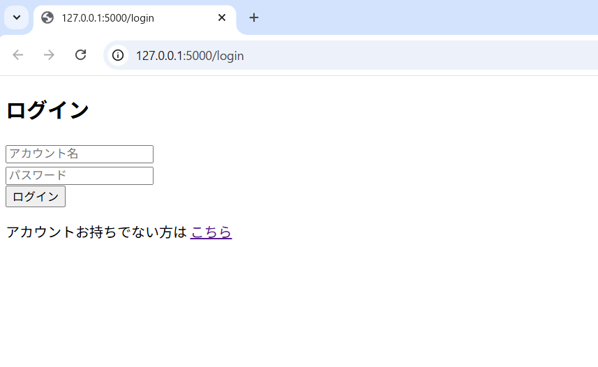
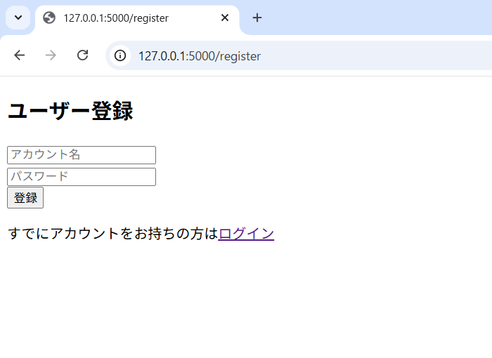
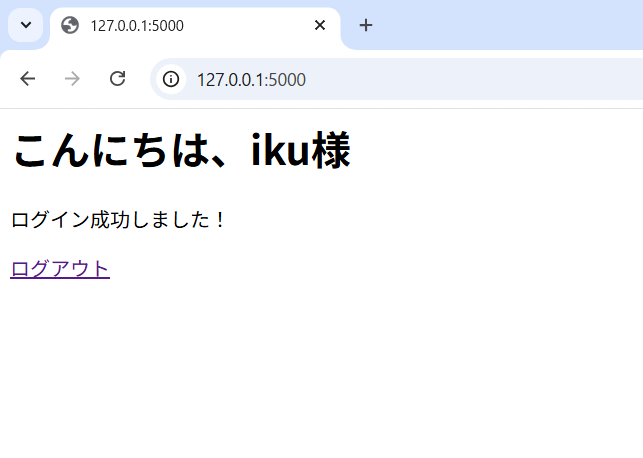

# Flaskログイン認証アプリ

Flaskを用いて作成したシンプルなユーザー認証システムです。

## 機能
- ユーザー登録
- ログイン / ログアウト
- パスワードのハッシュ化
- セッション管理
- 未ログイン時のリダイレクト制御

## 画面

### ログイン画面

### ユーザー登録画面

### ログイン後画面

## 使用技術
- Python / Flask
- Flask-SQLAlchemy
- SQLite
- Werkzeug

## 起動方法
pip install -r requirements.txt
python app.py

ブラウザで　http://127.0.0.1:5000　にアクセス

## 今後の改善
- バリデーション追加
- UI改善
- API化
- デプロイ

※ポートフォリオ用に作成